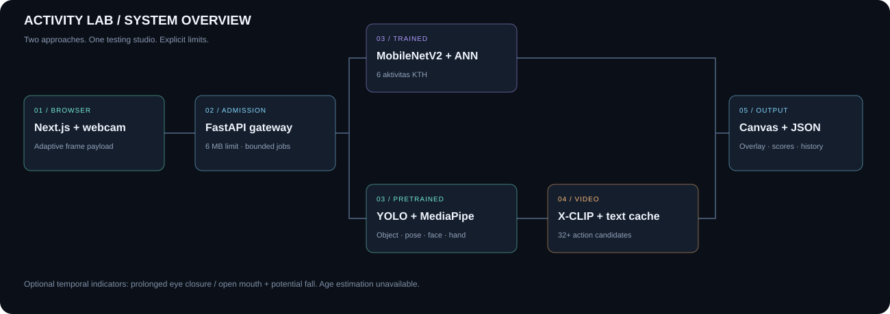
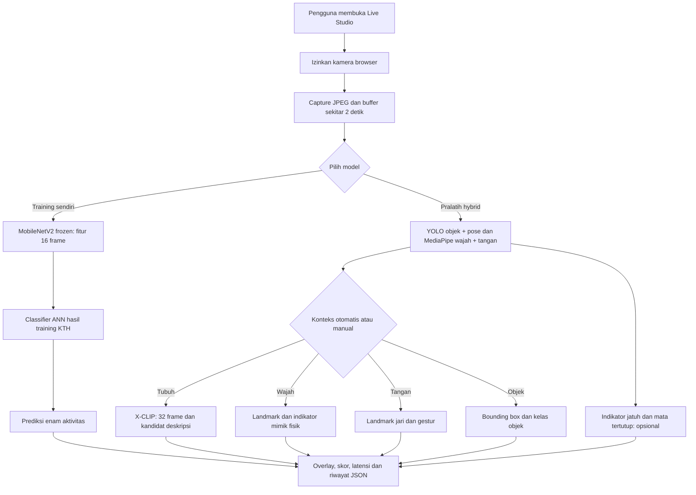
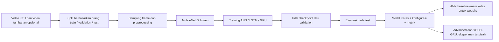
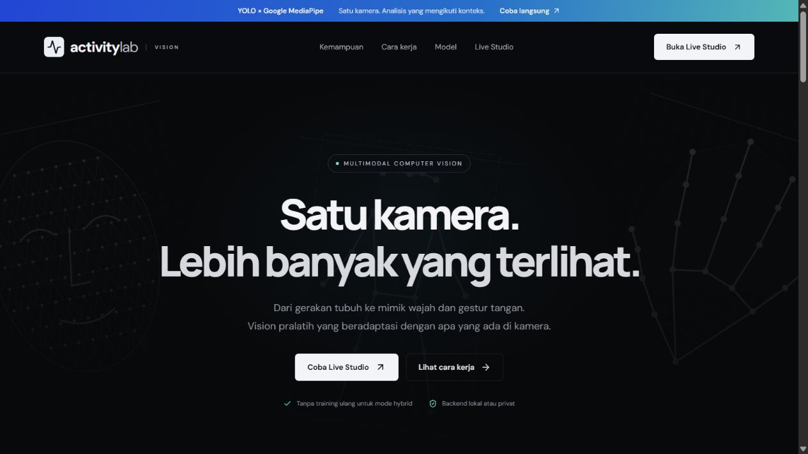
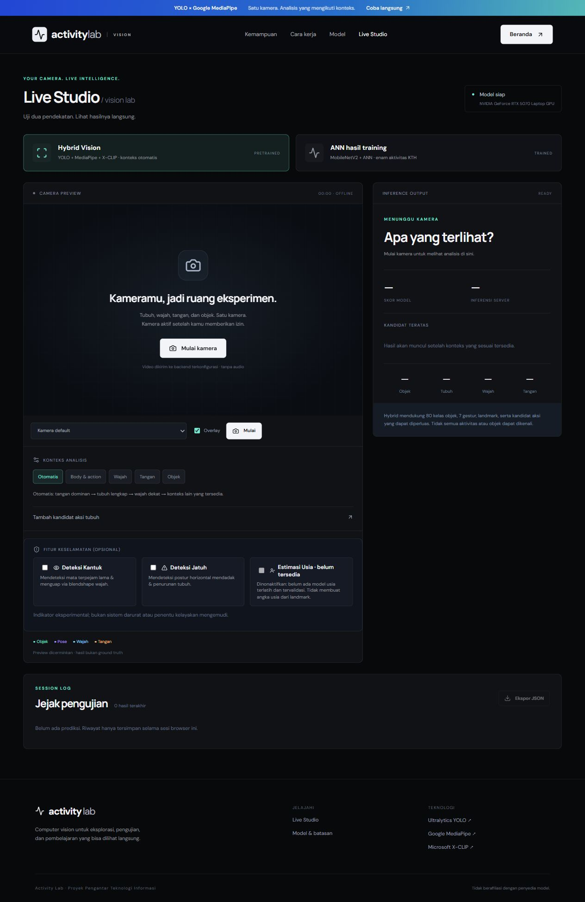

# Activity Lab

**Satu kamera. Dua pendekatan AI. Konteks yang beradaptasi.**

Next.js + FastAPI untuk membandingkan classifier ANN hasil training dengan pipeline pralatih YOLO, Google MediaPipe, dan Microsoft X-CLIP. Dikemas sebagai satu repository yang dapat dipindahkan tanpa bergantung pada folder eksperimen awal.



[Mulai cepat](#mulai-cepat) · [Arsitektur](docs/ARCHITECTURE.md) · [Deployment](docs/DEPLOYMENT.md) · [API](docs/API.md) · [Model & sumber](docs/MODELS.md) · [Hasil verifikasi](docs/VALIDATION.md)

## Alur aplikasi



## Alur training sendiri



## Notebook dan model hasil training

Notebook dan checkpoint yang telah dibuat tersedia langsung dalam repository:

| Materi | Notebook | Checkpoint dan hasil |
|---|---|---|
| Baseline enam aktivitas | [Local](notebooks/Pengenalan_Aktivitas_KTH_Local.ipynb) · [Colab](notebooks/Pengenalan_Aktivitas_KTH_Colab.ipynb) | [ANN terpilih, ANN best, LSTM best](trained-models/baseline/) |
| Adaptasi video lokal + idle | [Adaptasi](notebooks/Pengenalan_Aktivitas_KTH_Adaptasi.ipynb) | Notebook eksperimen; checkpoint adaptasi terpisah tidak ditemukan |
| Visual + optical flow, tujuh kelas | [Advanced](notebooks/Pengenalan_Aktivitas_KTH_Advanced.ipynb) | [ANN terpilih, ANN best, temporal best](trained-models/advanced/) |
| Perbandingan metode dan YOLO crop + GRU | [Research](notebooks/research/Perbandingan_KTH_YOLO.ipynb) | [E03 seed 42: GRU terlatih](trained-models/yolo-gru-e03/) |

Baca [panduan notebook](notebooks/README.md) dan [model card hasil training](trained-models/README.md). Salinan notebook publik mempertahankan kode tetapi membersihkan execution output; grafik dan metrik hasil sebelumnya disertakan terpisah. Dataset serta video pribadi tidak disertakan.

ANN website tetap checkpoint baseline enam kelas. Model advanced tujuh kelas dan YOLO-GRU memakai preprocessing berbeda; keduanya tidak otomatis menggantikan model live.

## Apa yang tersedia?

| Jalur | Komponen | Hasil |
|---|---|---|
| ANN hasil training | MobileNetV2 frozen → ANN KTH | Boxing, tepuk tangan, melambaikan tangan, jogging, berlari, berjalan |
| Hybrid: objek | YOLO11n | 80 kelas objek, bounding box, skor |
| Hybrid: tubuh | YOLO11n Pose + X-CLIP zero-shot | 17 keypoint, 32 kandidat aksi + maksimal 20 deskripsi tambahan |
| Hybrid: wajah | MediaPipe Face Landmarker | 478 landmark, 52 blendshape; ringkasan gerakan fisik wajah |
| Hybrid: tangan | MediaPipe Gesture Recognizer | 21 landmark/tangan, 7 gestur bawaan |
| Indikator opsional | Aturan temporal dari landmark | Mata/mulut tertutup/terbuka lama dan potensi jatuh; **eksperimental** |
| Usia | Belum tersedia | Rumus usia berbasis proporsi wajah telah dinonaktifkan; tidak menghasilkan angka palsu |

Mode otomatis memprioritaskan tangan yang mendominasi frame, tubuh lengkap, wajah dekat, lalu target lain yang tersedia. Mode manual juga tersedia. Overlay menampilkan semua target terdeteksi; route menentukan ringkasan utama. Action recognition adalah klasifikasi satu klip dengan subjek dominan, bukan label aksi terpisah untuk setiap orang.

## Pratinjau




Kamera baru aktif setelah tombol Mulai dan izin browser. Tidak ada audio yang diminta. Default pemrosesan lokal; saat menggunakan server remote, frame dikirim ke server tersebut. Backend tidak menyimpan frame. Riwayat JSON hanya berisi ringkasan hasil, bukan landmark lengkap atau gambar.

## Mulai cepat

**Prasyarat:** Python 3.12, Node.js 22 atau 24 LTS, npm, dan ruang disk untuk dependencies/checkpoint. GPU NVIDIA disarankan; CPU didukung tetapi kinerjanya perlu diukur pada perangkat tujuan. Video action membutuhkan model X-CLIP sekitar 780 MB. Tidak ada API berbayar.

### 1. Buat environment

```powershell
python -m venv .venv
.venv\Scripts\Activate.ps1
python -m pip install --upgrade pip
# CPU; untuk NVIDIA lihat docs/DEPLOYMENT.md
pip install torch==2.11.0 torchvision==0.26.0 --index-url https://download.pytorch.org/whl/cpu
pip install -r requirements.txt
Copy-Item .env.example .env
```

Linux/macOS: aktivasi dengan `source .venv/bin/activate`, lalu gunakan perintah pip yang sama. MediaPipe pada arsitektur/versi OS lain harus memiliki wheel yang kompatibel. CUDA tidak tersedia di macOS; gunakan CPU.

### 2. Siapkan checkpoint

```sh
python scripts/download_models.py
python scripts/import_ann.py trained-models/baseline
```

Downloader mengambil YOLO/MediaPipe dari sumber resmi, memverifikasi SHA-256, dan mengambil X-CLIP pada revision yang dipin. ANN baseline dan backbone sudah disertakan dalam `trained-models/baseline`; perintah import menyalinnya ke folder serving setelah memverifikasi [provenance](docs/ann-provenance.json). Tanpa ANN, hybrid tetap dapat dimuat; UI ANN tidak siap dan `/ready` bernilai 503. Tanpa X-CLIP, objek/pose/wajah/tangan tetap tersedia tetapi klasifikasi aksi tidak tersedia.

**Di laptop asal:** checkpoint sudah disalin lokal ke `backend/models/` dan diabaikan Git. Gunakan interpreter environment lama jika belum membuat environment baru; sumber paket ini tetap independen. Checkpoint publik yang disetujui berada di `trained-models/`; jangan commit dataset atau rekaman pribadi.

### 3. Jalankan backend

```sh
python scripts/serve.py
```

Backend: `http://127.0.0.1:8765` · API docs: `/docs` · status: `/health` · readiness: `/ready`. Biarkan terminal terbuka.

### 4. Jalankan website (terminal lain)

```sh
cd web
npm ci
# Salin .env.example ke .env.local bila URL API perlu diubah
npm run build
npm start
```

Buka `http://127.0.0.1:3000` → **Live Studio** → pilih model → Mulai kamera. Untuk pengembangan gunakan `npm run dev`. Hentikan kamera sebelum mengganti perangkat. Hentikan server dengan Ctrl+C.

## Pengujian & kualitas

```sh
pip install -r requirements-dev.txt
python -m unittest discover -s tests -v
python tests/check_xclip_parity.py  # membutuhkan checkpoint; CPU/GPU
cd web
npm run build
```

CI menguji aturan temporal, admission gate, batas payload, validasi API/CORS, serta build TypeScript. CI tidak mengunduh bobot atau mengklaim akurasi model. Lihat [VALIDATION](docs/VALIDATION.md) untuk hasil lokal dan pengujian yang masih diperlukan.

## Struktur repository

```text
activity-lab/
├── backend/              # FastAPI, hybrid, cache X-CLIP, safety rules
│   └── models/           # checkpoint lokal, diabaikan Git
├── web/                  # Next.js App Router, landing + live studio
├── notebooks/            # Colab, baseline, adaptasi, advanced, research
├── trained-models/       # checkpoint proyek, konfigurasi, metrik, grafik
├── scripts/              # server, download/import model, pemeriksaan rilis
├── tests/                # unit/API + parity model opsional
├── docs/                 # panduan, diagram, bukti verifikasi, sumber
├── deploy/               # Dockerfile, Compose, reverse proxy
├── .github/workflows/    # CI tanpa checkpoint
└── requirements*.txt
```

## Optimasi yang diterapkan

- Payload satu frame untuk face/hand/objects. Auto mengirim buffer saat route tubuh teramati dan melakukan probe buffer berkala agar tidak terjebak satu frame. ANN tetap mendapat jendela video.
- Cache text encoder X-CLIP terbatas empat set prompt. Video-conditioned prompt generator tetap dijalankan; diuji setara terhadap forward asli.
- Satu request aktif per tab; hasil sesi lama diabaikan. Server membatasi pekerjaan aktif/menunggu (`MAX_INFLIGHT`, default 2), serialisasi model, dan mengembalikan 429 saat penuh.
- Batas body ASGI 6 MB termasuk chunked transfer, batas frame/resolusi/timestamp, CORS origin eksplisit.
- State temporal terbatas, reset setelah gap/target hilang/pergantian target yang besar; histori browser menyimpan ringkasan ringan.
- CPU FP32 dan CUDA FP16 untuk X-CLIP. ANN preprocessing dan hash checkpoint asli dipertahankan.

Tidak ada klaim latensi <60 ms atau zero error. Latensi bergantung pada hardware, route, kualitas video, jaringan, dan pemanasan model. Overlay memakai hasil request terakhir sehingga tetap dapat tertinggal dari video.

## Deployment & batas production

Paket menyediakan konfigurasi deployment untuk **satu server inference** dan frontend Next.js. Belum ada autentikasi aplikasi, load test multi-user, atau validasi keselamatan. Gunakan di balik gateway autentikasi/HTTPS sebelum akses publik. [Panduan deployment](docs/DEPLOYMENT.md) menjelaskan opsi lokal, Docker, NVIDIA, Vercel, CORS dan pemisahan frontend/backend.

Deteksi jatuh dan indikator mata/mulut **bukan perangkat keselamatan, diagnosis kantuk, atau penentu apakah seseorang boleh mengemudi**. Tidak ada PERCLOS, EAR geometris, head-nod, identitas subjek, atau konfirmasi imobilitas yang tervalidasi. Wajah dan gerakan tidak digunakan untuk menebak emosi/kepribadian. Estimasi usia belum tersedia.

## GitHub

```sh
python scripts/check_release.py
# Dari direktori ini, setelah membuat repository GitHub kosong:
git init
git add .
git status --short
# Periksa daftar file sebelum commit/push.
git commit -m "Prepare Activity Lab application and documentation"
git branch -M main
git remote add origin https://github.com/USERNAME/REPOSITORY.git
git push -u origin main
```

Push belum dilakukan. `.gitignore` mengecualikan model runtime dalam `backend/models`, environment, video, log, secrets, node_modules dan build. Checkpoint hasil training yang diminta disertakan di `trained-models/`, disertai manifest SHA-256; tidak membutuhkan Git LFS karena setiap file berukuran di bawah 10 MB. Ketentuan dataset dan model pihak ketiga tetap berlaku. Lihat [sumber dan lisensi](docs/MODELS.md).
