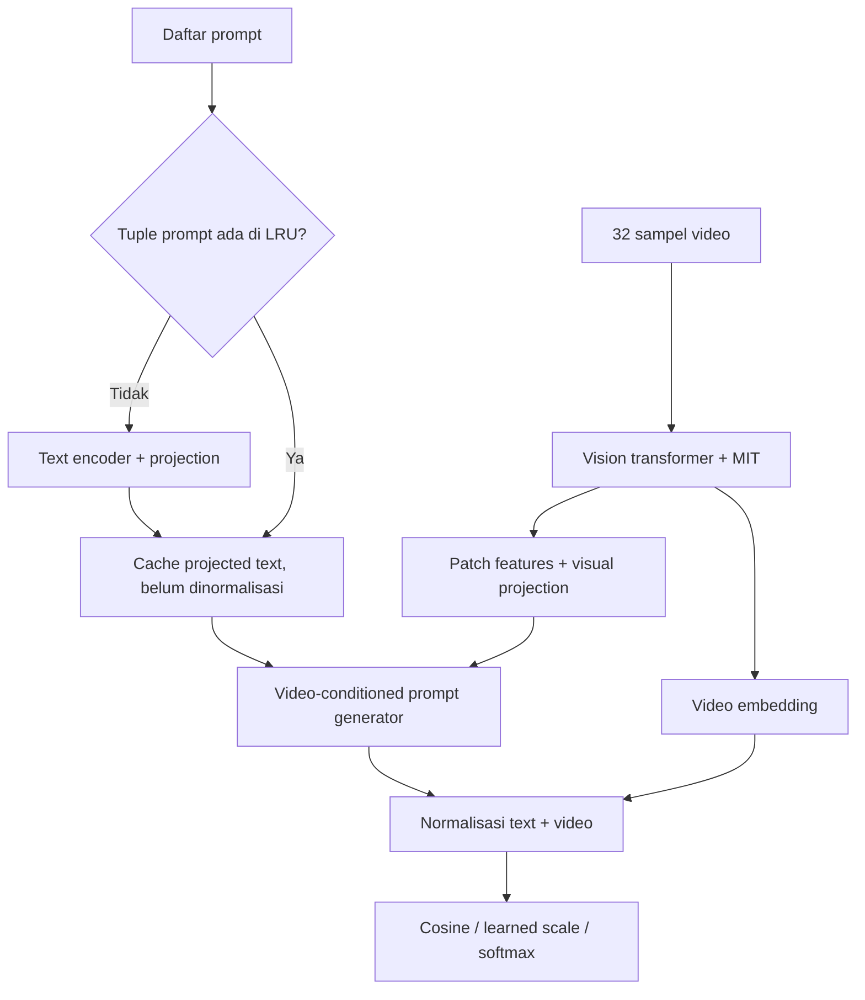

# Arsitektur

```mermaid
flowchart LR
  subgraph Browser[Browser / Next.js]
    Camera[Webcam tanpa audio] --> Capture[Capture target 16 fps]
    Capture --> Buffer[Ring buffer sekitar 2 detik]
    Buffer --> Payload{Mode + route terakhir}
    Payload -->|ANN / tubuh / auto probe| Clip[Buffer frame]
    Payload -->|Wajah / tangan / objek| Single[Frame terakhir]
  end
  Clip & Single --> Limits[ASGI 6 MB + validasi]
  Limits --> Gate{Admission: maksimum 2 job}
  Gate -->|Penuh| Busy[429 + Retry-After]
  Gate --> Lock[Model lock: serial]
  Lock --> Select{ANN atau hybrid}
  Select --> ANN[MobileNetV2 gray + ANN KTH]
  Select --> Perception[YOLO detect + pose / MediaPipe face + hand]
  Perception --> Route[Router geometris + stabilisasi]
  Route -->|Tubuh + cukup frame| Video[X-CLIP + bounded text cache]
  Perception --> Optional[Safety rules opsional]
  ANN & Route & Video & Optional --> JSON[JSON normalized coordinates]
  JSON --> Overlay[Canvas dicerminkan + ringkasan + log]
```

## Siklus request

1. Kamera dikonversi JPEG di browser; frame model tidak dicerminkan. Kamera preview dan koordinat overlay dicerminkan bersama.
2. Satu request per tab; setiap reset mengubah versi dan session ID. Hasil versi lama tidak dipakai.
3. Auto mengirim satu frame untuk respons ringan; jika `raw_route` tubuh teramati, request berikut menggunakan buffer. Probe setiap 2,5 detik menghindari ketergantungan pada route lama.
4. Server memvalidasi ukuran aktual body, timestamp dan gambar. Maksimum dua job diterima, termasuk yang menunggu lock; lainnya 429.
5. Inferensi dijalankan di thread. Slot admission dibebaskan setelah thread selesai, termasuk ketika koneksi pemanggil dibatalkan.
6. Hybrid menjalankan seluruh perception pada frame terbaru, sehingga kotak objek/landmark tetap muncul bersamaan. Action membutuhkan ≥8 frame dan span ≥1,6 detik; ANN UI menunggu 16 frame dan sekitar 1,9 detik.
7. History maksimal 80 ringkasan di browser; 12 ditampilkan. Tidak menyimpan frame atau seluruh landmark ke history.

## Cache X-CLIP

Menggunakan dot-product `get_video_features` dengan text embedding saja akan melewati prompt generator. Implementasi `xclip_cache.py` mempertahankan tahapan forward asli untuk Transformers 4.57.3. Uji parity wajib diulang saat library atau implementasi model berubah.

## State & batas subjek

Route stabil setelah dua observasi yang konsisten. State temporal menggunakan jam monotonik server, bukan timestamp yang bebas diatur client. State indikator direset setelah gap >2 detik, target hilang, atau overlap bounding box sangat kecil. Ini bukan pelacakan identitas; perpindahan orang masih dapat membingungkan indikator. Gunakan satu subjek untuk uji safety.

Rasio postur jatuh dikoreksi menurut aspek gambar `(box_width_normalized * image_width/image_height) / box_height_normalized`. Postur horizontal saja tidak diberi label jatuh: diperlukan penurunan teramati lalu postur horizontal berkelanjutan. Belum ada validasi klinis atau detektor imobilitas.
